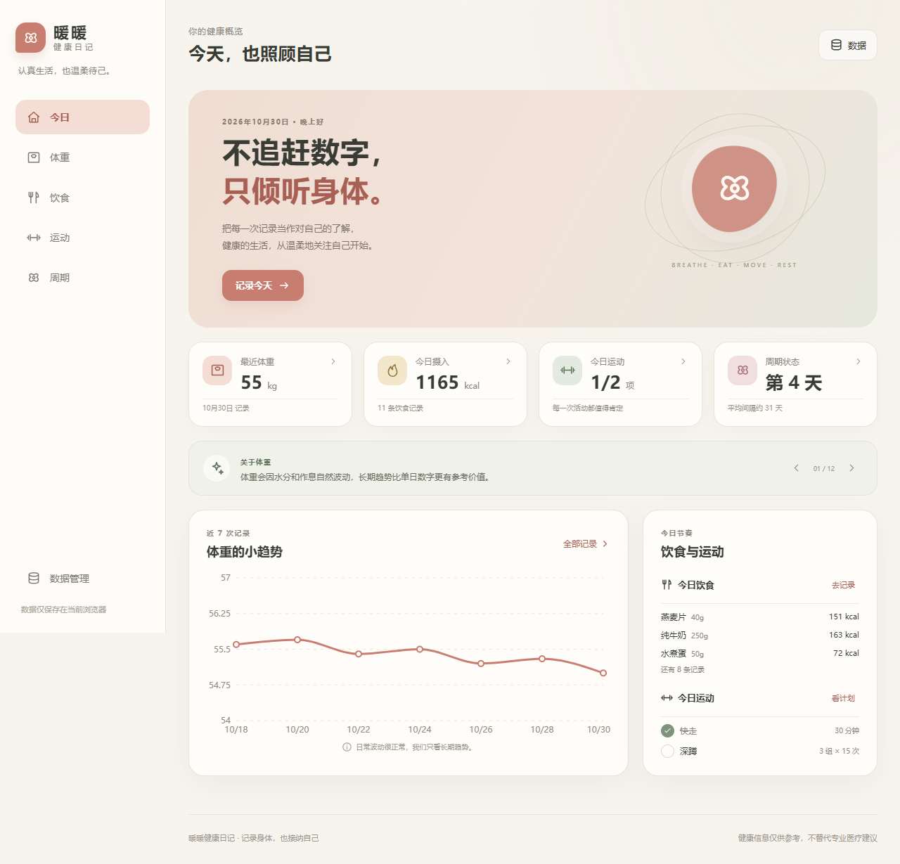
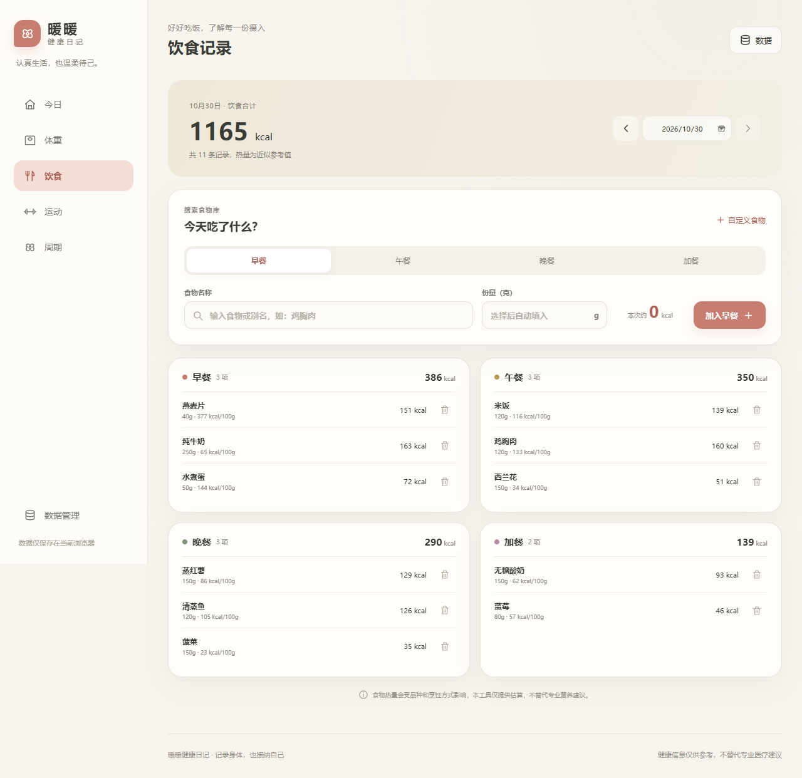
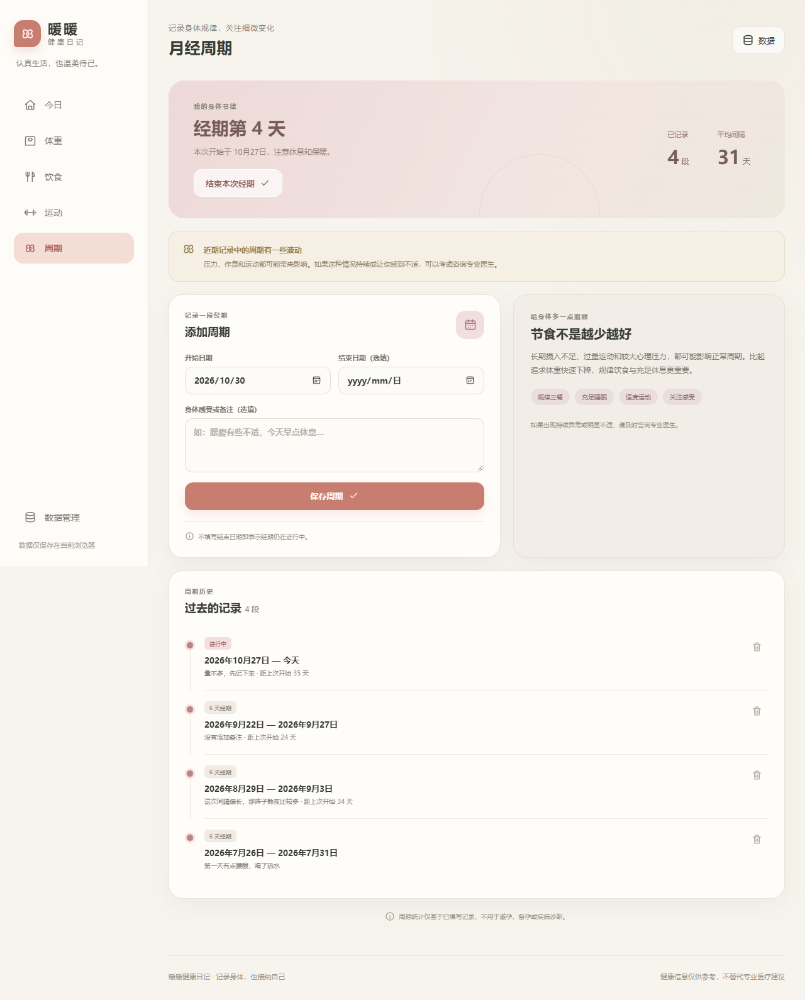
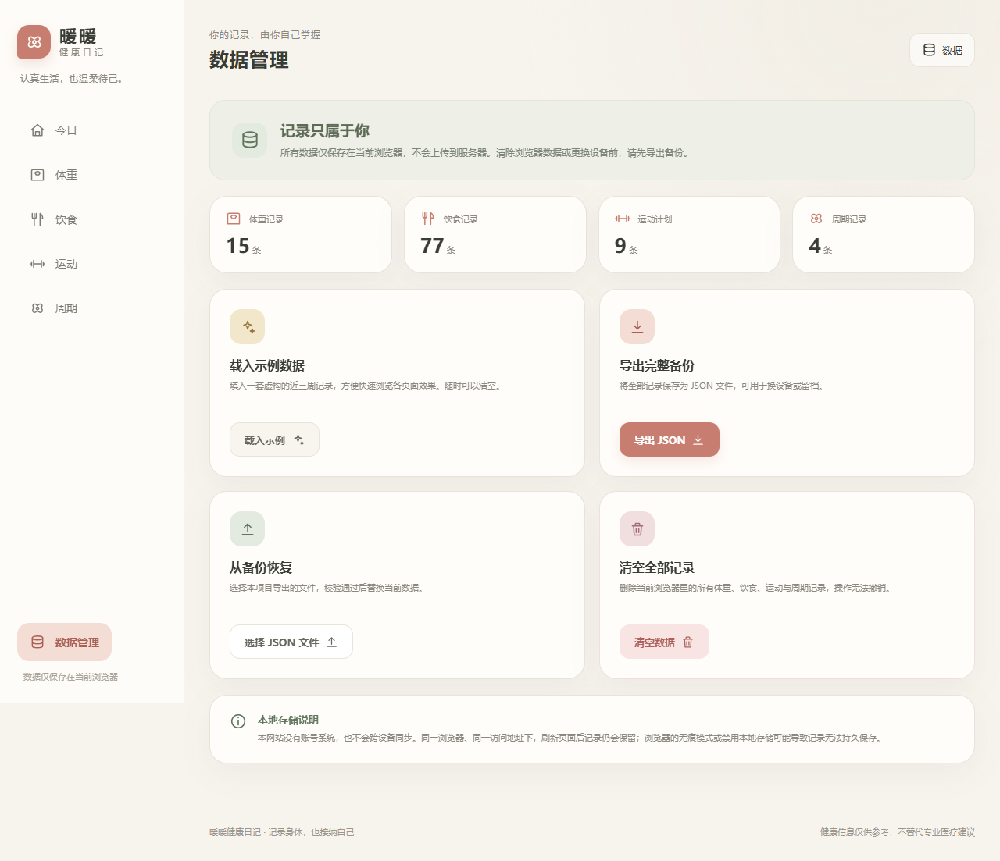
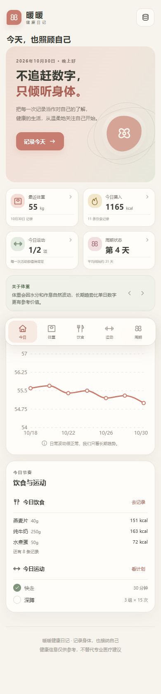

# 暖暖健康日记

一个面向减脂期女生的响应式健康记录网站。项目强调温和记录和长期趋势，不鼓励极端节食，也不用单日体重评价用户。



> 第一次打开是空白记录。想快速查看完整效果，进入「数据管理 → 载入示例数据」，会填入一套虚构的近三周记录，随时可以清空。

## 页面预览

| 饮食记录 | 月经周期 |
| --- | --- |
|  |  |

| 数据管理 | 手机端（390px） |
| --- | --- |
|  |  |

## 基本用途

- **首页概览**：汇总最近体重、今日摄入、运动完成情况和周期状态，并轮播健康科普短句。
- **体重记录**：按日期记录体重与感受，同一天重复提交会更新原记录；支持趋势图、历史编辑和删除。
- **饮食记录**：搜索常见食物或别名，输入克数后自动估算热量；按早餐、午餐、晚餐、加餐分组；支持自定义食物。
- **运动计划**：记录有氧运动时长或力量训练组数、次数，支持完成打卡、取消完成和删除。
- **月经周期**：记录经期开始与结束日期、持续天数和周期间隔，可结束正在进行的经期；对明显波动仅做温和提醒。
- **数据管理**：载入示例数据、导出/导入 JSON 备份、清空全部记录。

## 设计思路

1. **温和而非焦虑**：使用奶油白、浅桃和鼠尾草绿，不设置热量超标警告、减重排名或极端目标。
2. **从空白开始**：首次打开不预填任何体重、饮食或周期数据，所有内容都由使用者自己记录；需要预览完整效果时可以手动载入示例数据，示例数据随时可以清空。
3. **简单且可持久化**：使用浏览器 localStorage，无需注册或后端；同一浏览器和访问地址下刷新后记录仍保留。
4. **移动端优先**：手机采用卡片和底部导航，桌面采用侧边导航和双列布局。
5. **健康边界清晰**：食物热量是近似参考值，周期功能不用于医疗诊断、避孕或备孕。

## 技术栈

- React 19
- Vite 6
- Recharts
- 原生 CSS
- localStorage + Blob / File API

不依赖外部食物 API、AI 服务或云端数据库。

## 本地运行

环境要求：Node.js 20 或更高版本。

```bash
npm install
npm run dev
```

打开终端显示的本地地址。生产构建与预览：

```bash
npm run build
npm run preview
```

## 数据说明

- localStorage 键：`warm-health-diary:v2`。
- 首次访问为空白记录，不自动生成演示数据。
- 「载入示例数据」需要手动点击，且会替换当前记录（已有记录时会先确认）。
- 旧版本 `warm-health-diary:v1` 中预填的演示数据会在启动时移除。
- “清空数据”会删除当前浏览器中的全部记录，刷新后不会恢复。
- “导入备份”会替换当前记录，操作前需要确认。
- 饮食记录保存食物名称和当时的热量快照，修改自定义食物不会影响历史。
- 导入仅接受本项目导出的、不超过 2MB 的 JSON 文件；校验失败不会修改当前数据。
- 本网站无账号系统，不能跨设备同步。清除浏览器数据前请先导出备份。

## 项目结构

```text
src/
├── components/    # 导航、图标、趋势图、科普轮播、空状态
├── data/          # 常见食物、空白数据、示例数据、健康短句
├── hooks/         # 健康数据 Reducer 与本地持久化
├── lib/           # 日期、统计、存储和校验
├── pages/         # 首页、体重、饮食、运动、周期、数据管理
├── App.jsx
├── main.jsx
└── styles.css

docs/screenshots/  # README 使用的界面截图
```

## GitHub Pages

仓库已包含 `.github/workflows/deploy.yml`。推送到 GitHub 的 `main` 分支后，在仓库 **Settings → Pages → Source** 中选择 **GitHub Actions**，工作流会构建并部署 `dist`。

```bash
git remote add origin <你的仓库地址>
git branch -M main
git push -u origin main
```

## 健康声明

本项目为课程作业。食物热量受品种、份量和烹饪方式影响，页面数据仅供记录参考；周期统计与健康短句不能替代专业医疗建议。如出现持续乏力、头晕、月经明显异常或其他不适，请及时咨询专业医生。
